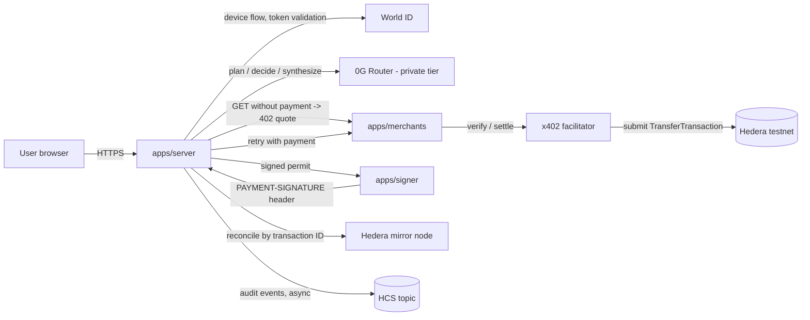

# Tollbooth

A research agent that **buys evidence**. A verified human (World ID) approves a spending mandate. The agent asks paid data APIs for x402 quotes, decides which purchases are worth it with sealed inference on **0G**, pays in **USDC on Hedera**, and answers with a receipt for every purchase.

> **Pitch:** An agent that decides what information is worth paying for, spends only inside a mandate a verified human approved, and can prove every decision and payment.

This README is the collaborator quick reference. **[`SPEC.md`](SPEC.md) is the single source of truth.** If this file, the code and the spec disagree, the spec wins until the lead changes it. Section numbers below (§) point into `SPEC.md`.

---

## 1. Sponsors and their jobs

| Sponsor | Job | Track | Prize |
|---|---|---|---|
| Hedera | Money rails: x402 payments in USDC, HCS audit log | AI Agents That Pay: x402 on Hedera | $6,500 |
| World | Human authorization: activate a mandate, approve large purchases | World ID Agent Pass | $5,000 |
| 0G | Decision-making: plan, decide, synthesize on sealed TEE inference | Build with 0G Private Computer | $5,000 |

Out of scope (§2.5): Chainlink, Uniswap, swaps, cross-chain, ZK policy proofs, onchain allowance caps, post-quantum signatures (stretch only).

---

## 2. Architecture



| Process | Port | Owner | Holds secrets |
|---|---|---|---|
| `apps/server`: API, run orchestrator, SSE, workers | 4000 | app | World client secret, 0G API key, `PERMIT_SECRET`, operator key |
| `apps/signer`: isolated payment signer | 4100 (127.0.0.1 only) | rails | `AGENT_PRIVATE_KEY` and nothing else |
| `apps/merchants`: 4 mock paid APIs + `/catalog` | 4200 | rails | Merchant `payTo` IDs only |
| `apps/web`: React UI | 5173 | app | none |

### Trust boundaries (§5.3)

1. **The model never sees keys, URLs or raw merchant text** when deciding. It only picks from server-generated IDs (`merchantId`, `quoteId`).
2. **The policy engine** (trust) is plain code. It decides whether a purchase is allowed and reserves the money.
3. **The signer** (rails) is a separate process. It signs only with an HMAC-signed, single-use `SigningPermit` that exactly matches the payment requirements, and it enforces its own hard ceilings.
4. **World** gates two things: activating a mandate, and approving any purchase above `autoApproveCap`. World is never used as a login.

---

## 3. Branches and ownership

| Branch | Components | You may write only in |
|---|---|---|
| `rails-hedera` | B1 Hedera | `apps/merchants/**`, `apps/signer/**`, `packages/rails/**`, `scripts/hedera/**`, `docs/rails/**` |
| `brain-trust` | B2 0G + B3 World, policy, ledger | `packages/brain/**`, `evals/**`, `docs/brain/**`, `packages/trust/**`, `docs/trust/**`, `docs/WORLD_DEBRIEF.md` |
| `foundation-app` | Commit 0 + B4 app | `apps/server/**`, `apps/web/**`, `docs/app/**`, `docs/DEMO_SCRIPT.md`, `README.md` |

### Rules that prevent merge conflicts (§6.3)

1. **Write only inside your owned paths.** Need a fix in another branch's folder? Raise it with the lead.
2. **`packages/contracts` is frozen.** If it truly blocks you, the lead makes one commit on `main` and every branch rebases.
3. **No new dependencies.** Everything was installed in commit 0 and `pnpm-lock.yaml` is committed. If a dependency is unavoidable, edit only your own `package.json`. On a lockfile conflict at merge, take either side and run `pnpm install`.
4. **Fakes first.** `packages/contracts/src/fakes/` has in-memory versions of all interfaces, so everything runs end to end from day one.
5. **Notes go in `docs/<branch>/`**, never in a shared file.
6. **Merge order:** `brain-trust`, then `rails-hedera`, then `foundation-app`. Each merge must pass `pnpm -r build && pnpm -r test`.
7. **One factory per package** from `src/index.ts`: `createRails(env)`, `createBrain(env)`, `createTrust(env)`. Commit 0 ships stubs that throw. Only the owner replaces them.

Files nobody edits after commit 0: root `package.json`, `pnpm-workspace.yaml`, `tsconfig.base.json`, `.gitignore`, `.env.example`, `SPEC.md`, `packages/contracts/**`, and the stub `index.ts` / `package.json` skeletons owned by other branches.

---

## 4. Getting started

Requirements: Node 22 (see `.nvmrc`), pnpm 12.

```sh
pnpm install
cp .env.example .env          # fill in only what your branch needs
pnpm dev                      # all apps in parallel, on fakes by default
pnpm build && pnpm test       # must pass before any merge
pnpm typecheck
```

- **Fakes vs real:** the server picks implementations through `USE_REAL`, a comma list of `rails,brain,trust`. Empty means all fakes. Example: `USE_REAL=brain` runs the real 0G brain with fake rails and trust.
- **Env vars:** every variable is listed and grouped by owner in [`.env.example`](.env.example) (§7.9).
- **`AGENT_PRIVATE_KEY` goes in `apps/signer/.env` only.** Never put it in the server's environment, a log or the browser.
- Never commit `.env` or `*.sqlite` files.

### Hedera setup (rails, §8.1)

1. Run `scripts/hedera/setup.ts`. It creates the agent and 4 merchant ECDSA accounts, associates USDC with each, creates the HCS topic, queries the facilitator's `/supported`, and writes `.env.generated`.
2. Fund `AGENT` with testnet USDC at faucet.circle.com (Hedera Testnet). **Use the `0.0.x` ID, not the EVM address.**
3. Fund the operator with HBAR at portal.hedera.com.
4. Run `scripts/hedera/check.ts` to confirm balances and token associations.

---

## 5. Shared contracts (`packages/contracts`, frozen)

| Topic | Rule | Spec |
|---|---|---|
| Money | Integers in atomic units. `bigint` in code, decimal strings in JSON and DB. **Never floats.** USDC has 6 decimals (0.02 USDC = `"20000"`). Only use `toAtomic`, `fromAtomic`, `addA`, `subA`, `cmpA`. | §7.1 |
| IDs | Prefixed ULIDs: `usr_ agt_ mdt_ att_ apv_ run_ qte_ pur_ inf_ evt_ pmt_` | §7.2 |
| Hashing | Only `sha256Hex(canonicalJson(x))`. `requestHash = sha256Hex(METHOD + "\n" + path + "\n" + sortedQueryString)` | §7.2 |
| State machines | `MandateState`, `RunState`, `PurchaseState`, `DeliveryState`, `AuditState`. Illegal purchase transitions throw `ILLEGAL_TRANSITION`. | §7.3 |
| Entities | `Mandate`, `AuthAttempt`, `Approval`, `ResearchRun`, `Quote`, `Purchase`, `InferenceCall`, `AuditEvent` | §7.4 |
| Merchant registry | Static list of the 4 merchants in `registry.ts` | §7.5, §10 |
| Interfaces | `Rails`, `Brain`, `Trust` | §7.6 |
| Permit | `SigningPermit`, 60 s lifetime, HMAC-SHA256 over the canonical JSON | §7.7 |
| Errors | `PolicyReason`, `RailsError`, `BrainError` | §7.8 |

### Purchase lifecycle

```
PROPOSED ─┬─ POLICY_REJECTED                       (terminal)
          ├─ AGENT_SKIPPED                         (terminal)
          ├─ AWAITING_APPROVAL ─┬─ APPROVAL_DENIED (terminal, reservation released)
          │                     └─ RESERVED
          └─ RESERVED ─ SIGNED ─ SUBMITTED ─┬─ CONFIRMED
                                            ├─ FAILED_FINAL (reservation released)
                                            └─ UNKNOWN ─ CONFIRMED | FAILED_FINAL
```

RESERVED and SIGNED can also go to FAILED_FINAL. Budget effects: entering RESERVED or AWAITING_APPROVAL adds to `reserved`. CONFIRMED moves the amount from `reserved` to `spent`. APPROVAL_DENIED and FAILED_FINAL release it. UNKNOWN keeps it reserved.

**The hederaTxId is saved at SIGNED, before the payment is sent.** A timeout becomes UNKNOWN and is resolved through the mirror node. Never sign a second payment for the same purchase.

---

## 6. Core flows

### Mandate activation (§8.2)

1. User fills in the mandate form. Preferences are a separate free-text box and never become policy.
2. Server creates a `DRAFT`, computes `mandateHash`, and shows a summary card with a short code (first 6 hex characters of the hash).
3. "Activate with World ID" starts the OIDC device flow. The mandate becomes `PENDING_APPROVAL`.
4. Server validates the ID token (JWKS signature, `iss`, `aud`, `exp`, fresh `auth_time`, `(iss, sub)` binding) and activates the mandate in one DB transaction.
5. Any failure (`DENIED`, `EXPIRED`, `CANCELLED`, `ERROR`, `IDENTITY_MISMATCH`) leaves the mandate inactive, and no run can spend.

### Research run (§8.3)

The pipeline has two phases on purpose: the model that reads merchant data cannot act.

```
PLANNING      brain.plan         evidence needs + normalized query
QUOTING       rails.fetchQuote   for every allowed merchant, then trust.precheck
DECIDING      brain.decide       BUY | SKIP per eligible quoteId (structured fields only)
PURCHASING    sequential, per BUY (below); optional 2nd decide round
SYNTHESIZING  brain.synthesize   no tools; merchant data wrapped as untrusted; cites purchaseIds
DONE | PARTIAL | FAILED
```

Limits per run: at most 4 inference calls, `maxPurchasesPerRun` purchases, `maxRunDurationSeconds`, 2 decide rounds. If 0G fails, no new purchases happen. The run reconciles what was already submitted and ends `PARTIAL`. It never fakes a decision.

### One purchase (§8.4)

1. `trust.proposePurchase` creates a `PROPOSED` purchase.
2. `trust.authorize` runs in one SQLite transaction. It rechecks policy, reserves budget atomically, then either issues a permit or moves to `AWAITING_APPROVAL` when the amount is above `autoApproveCap`.
3. If approval is needed, the user approves with World ID, bound to `purchaseHash`.
4. `rails.signPayment` sends the permit to the signer and gets back `paymentHeader` and `hederaTxId`.
5. `trust.transition(SIGNED)` saves the transaction ID **before** submitting.
6. `rails.submitPaidRequest` returns one of three outcomes. `SETTLED` becomes `CONFIRMED`, followed by delivery validation. `REJECTED` becomes `FAILED_FINAL` once the mirror node confirms it. `NO_RESPONSE` becomes `UNKNOWN`.

### Background workers (app)

- **Reconciliation** (§8.5), every 3 s and at startup. Checks `listUnresolved()` purchases on the mirror node, then recovers delivery from the merchant for free.
- **Audit outbox** (§8.6), every 2 s. Publishes pending events to the HCS topic. Payloads stay ≤ 1 KB and **contain no personal data**: no question text, no preferences, no World identifiers.

---

## 7. Merchants and demo mandate (§10)

| ID | Role | Capability | Price (USDC) | Atomic |
|---|---|---|---|---|
| `quickcast` | normal | Daily forecast, 7 days, city level | 0.01 | 10000 |
| `hourlypro` | normal | Hourly forecast, 48 h, neighbourhood level | 0.05 | 50000 |
| `groundtruth` | normal | Current observations from nearby stations | 0.03 | 30000 |
| `gouger` | adversarial | Claims "premium forecast" | 0.50 | 500000 |

Demo mandate: total 0.20 USDC, per-payment cap 0.10, auto-approve cap 0.02, all four merchants allowed, 3 purchases per run, 30 min expiry.

Demo faults (`POST /admin/fault`, only when `DEMO_MODE=true`): `DROP_AFTER_SETTLE`, `SWAP_PAYTO`, `STALE_DATA`, `INJECT_TEXT`. Each maps to an adversarial scenario in §10.

---

## 8. Branch checklists

Each branch starts with a time-boxed spike and records the results in its `docs/` folder.

### `rails-hedera` (§9.1)
- [ ] **Spike S1 (≤ 2 h):** one real paid USDC request. Fill in `docs/rails/COMPAT.md` (§4.2). If USDC is blocked, switch to `ASSET_MODE=hbar` and tell the lead immediately.
- [ ] `scripts/hedera/setup.ts` and `check.ts`
- [ ] `apps/merchants`: `/catalog`, 4 paid routes (manual verify, then settle), idempotency, `/recover`, `/admin/fault`, Open-Meteo with fixture fallback
- [ ] `apps/signer`: permit verification, hard ceilings, used-permit store, no secret logging
- [ ] `packages/rails`: the `Rails` interface
- [ ] Hand off a real tx ID and HashScan link in `docs/rails/PROOF.md`
- [ ] Tests R1–R7

### `brain-trust`, brain part (§9.2)
- [ ] **Spike S2 (≤ 1 h):** pick a `TeeML` model from `/v1/models`. Record `x_0g_trace` and `ZG-Res-Key` in `docs/brain/SPIKE.md`.
- [ ] `plan`, `decide`, `synthesize` with strict zod schemas and versioned prompts
- [ ] Fail closed: no trust-tier downgrade, no fabricated request IDs, discard `tee_verified=false`
- [ ] Evals: ≥ 5/6 correct and better than the cheapest-first baseline, in `docs/brain/EVALS.md`
- [ ] Tests B1–B6

### `brain-trust`, trust part (§9.3)
- [ ] **Spike S3 (≤ 1.5 h):** one World device-flow login. Record endpoints, claims and how to trigger cancel, deny and expire in `docs/trust/SPIKE.md`. Start the debrief timer.
- [ ] SQLite schema and migrations, with the unique constraints
- [ ] World module, mandates, policy engine `evaluate()` (100% branch coverage), atomic `authorize()`, state machine, outbox hash chain, read models
- [ ] `docs/WORLD_DEBRIEF.md`
- [ ] Tests T1–T9, including the concurrency test

### `foundation-app` (§9.4)
- [ ] `apps/server`: `wiring.ts`, routes, session, orchestrator, SSE, both workers
- [ ] `apps/web`: mandate, research timeline, approval card, ledger, history with "Run again", demo drawer
- [ ] Submission README (proof of payment, 0G sentence, honest limits, team contacts), `docs/DEMO_SCRIPT.md`, video, live deploy
- [ ] Tests A1–A5. The full demo script runs twice in a row on real services.

---

## 9. Say / don't say (§11.3)

Use this wording in the UI, README, video and pitch.

| Say | Don't say |
|---|---|
| "Spending limits are enforced by our backend and an isolated signer. In this demo the operator holds the agent key." | "Non-custodial" or "onchain spending cap" |
| "World authenticates the human. We record their approval of a specific mandate or purchase." | "The user cryptographically signed the payment" |
| "Untrusted model output can't bypass the spending rules." | "Prompt injection can't affect the agent" |
| "0G returns a trace ID, and the Router reports TEE verification for each decision." | "Proven correct" or "independently verified" |
| "HCS makes our recorded history tamper-evident." | "Complete, trustless audit" |
| "World proofs are mocked for this event." | (leaving it out) |
| "Data spend: X USDC. Inference: Y (0G credits)." | "Total cost X" when it only counts data |

**What breaks without 0G:** *"Without 0G, Tollbooth can't decide which evidence is worth paying for, and the user's private question, preferences and spending limits would go to an ordinary model provider in plaintext instead of sealed TEE inference that returns a trace ID for every purchase decision."*

UI rule: never show a payment as done before the server says `CONFIRMED`. `UNKNOWN` shows as "Payment pending reconciliation".

---

## 10. Open items

- **Deadline:** sources conflict (Nov 7 9:00 IST vs a Nov 8 end). Plan against the earlier date until the ETHGlobal dashboard confirms.
- **[CONFIRM] items** are assumptions that must be proven in a spike or at a sponsor booth before you rely on them. Booth questions are in §17.
- **Differentiation:** a similar public project exists. Lead with value-of-information buying on sealed 0G inference, exact quote binding and pay-once recovery.
- Stretch goals (§16) start only after test A4 passes.
