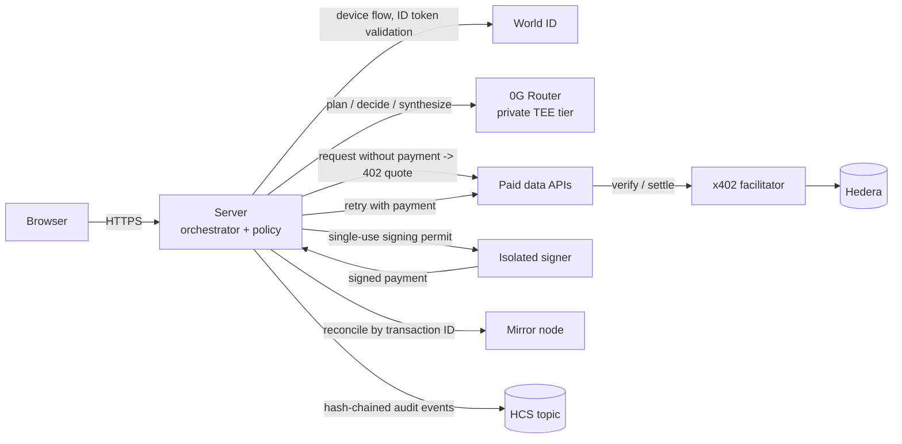

# Tollbooth

**A research agent that decides what information is worth paying for, spends only inside a mandate a verified human approved, and can prove every decision and payment.**

You ask Tollbooth a question. It works out what evidence it is missing, gets price quotes from paid data APIs, buys only the sources worth their cost, and answers with a receipt for every purchase. A verified human approves the budget, and any larger purchase needs that human's approval again.

| | |
|---|---|
| **Human authorization** | World ID Agent Pass |
| **Decisions** | Sealed TEE inference on 0G |
| **Payments** | x402 in USDC on Hedera |
| **Audit trail** | Hedera Consensus Service |

---

## How it works

1. **Approve a mandate.** You set a total budget, a cap per payment, an auto-approve threshold, the allowed merchants and an expiry. You activate it with World ID. Tollbooth records your approval of that exact mandate version.
2. **Ask a question.** For example: *"Will it rain in Mumbai tomorrow afternoon?"*
3. **The agent plans.** It turns the question into specific evidence needs, such as an hourly forecast for one neighbourhood and one time window.
4. **Merchants quote.** Each allowed data API answers with an x402 `402 Payment Required` quote: price, recipient, asset and expiry.
5. **The agent decides.** Sealed inference on 0G picks which quotes to buy and which to skip, with a reason for each. Every decision returns a 0G trace ID.
6. **Policy enforces, the signer pays.** A deterministic policy engine checks every purchase against the mandate and reserves the money. An isolated signer pays in USDC on Hedera. Any purchase above the auto-approve threshold first needs a fresh World ID approval bound to that one purchase.
7. **You get an answer with receipts.** The answer cites the purchases it relied on. Each purchase links to its Hedera transaction and its 0G decision. Audit events are anchored to an HCS topic.

---

## Architecture

| Component | Role |
|---|---|
| **Web app** | Mandate setup, live research timeline, approval cards, ledger and run history. Holds no secrets. |
| **Server** | Runs the research pipeline, the policy engine and the SQLite ledger. Also runs background workers for payment reconciliation and audit publishing. |
| **Isolated signer** | A separate process that holds the agent's key and nothing else. It signs only against a single-use, HMAC-signed permit that exactly matches the payment, and it enforces its own hard spending ceilings. |
| **Paid data APIs** | x402-protected endpoints that return quotes, settle through the facilitator, and support idempotent recovery of data already paid for. |

---

## Tech stack

| Layer | Technology |
|---|---|
| Language and tooling | TypeScript (strict), Node.js 22, pnpm workspaces, Vitest |
| Frontend | React 18, Vite, Tailwind CSS |
| Backend | Express 5, server-sent events for live run updates |
| Data | SQLite (better-sqlite3), append-only migrations, atomic budget reservations |
| Validation | zod schemas at every boundary, including all model output |
| Identity | World ID Agent Pass over the OIDC device flow, with ID tokens verified using `jose` (JWKS, issuer, audience, fresh `auth_time`) |
| AI | 0G Router (OpenAI-compatible) on the private TEE tier, with structured output and versioned prompts |
| Payments | x402 v2 (`@x402/core`, `@x402/hedera`), USDC on Hedera testnet, `@hiero-ledger/sdk` |
| Audit | Hedera Consensus Service topic and a mirror node for reconciliation |

---

## Security model

The model only proposes. Plain code decides, and a separate process signs.

- **The model can't reach the money.** When deciding, the model never sees keys, URLs or raw merchant text. It can only pick from IDs the server generated. The model that reads merchant data has no tools and cannot buy anything.
- **Deterministic policy.** Every purchase is checked against the mandate: the merchant is allowed, the recipient and asset match exactly, the amount is within the per-payment cap and the remaining budget, the quote hasn't expired, the price isn't anomalous, and the request isn't a duplicate. The budget is reserved in a single database transaction.
- **An isolated signer with its own limits.** The signer accepts only a short-lived, single-use permit bound to the exact payment requirements, and it caps spend per transaction and in total, whatever the server asks.
- **A human for anything that matters.** Activating a mandate, and any purchase above the auto-approve threshold, needs a fresh World ID authentication. The approval is bound to the hash of that specific mandate or purchase and is single-use.
- **Pay once, even on failure.** The Hedera transaction ID is saved before a payment is sent. A timeout is resolved against the mirror node, never by paying again, and data already paid for is recovered from the merchant for free.
- **Tamper-evident history.** Audit events are hash-chained and anchored to HCS. They carry no personal data: no question text, no preferences, no World identifiers.

---

## Proof of payment

A USDC payment through the full stack (quote, permit, isolated signer, x402 settlement, mirror-node confirmation) on Hedera testnet:

| | |
|---|---|
| Transaction | [`0.0.9185802@1793984794.908601245`](https://hashscan.io/testnet/transaction/0.0.9185802@1793984794.908601245) |
| Amount | 0.01 USDC (token `0.0.429274`) |
| Pay-once recovery | [`0.0.9185802@1793984803.504843327`](https://hashscan.io/testnet/transaction/0.0.9185802@1793984803.504843327): response dropped after settlement, payment confirmed on the mirror node, data recovered, one transfer only |
| Audit topic | [`0.0.11341856`](https://hashscan.io/testnet/topic/0.0.11341856) |

More detail is in [`docs/rails/PROOF.md`](docs/rails/PROOF.md).

---

## Why 0G

Without 0G, Tollbooth can't decide which evidence is worth paying for. The user's private question, preferences and spending limits would also go to an ordinary model provider in plaintext. With 0G they go to sealed TEE inference that returns a trace ID for every purchase decision.

---

## Honest limits

- Spending limits are enforced by our backend and the isolated signer, not on-chain. In this demo the operator holds the agent key, so Tollbooth is custodial.
- World authenticates the human, and we record their approval of a specific mandate or purchase. The user does not sign the payment: the agent's key does. World proofs are mocked for this event.
- The 0G Router reports TEE verification for each decision. We record that report and the trace ID; we don't verify the TEE attestation independently.
- Untrusted model output can't bypass the spending rules. Prompt injection in merchant data can still distort the written answer, so Tollbooth flags suspicious content.
- HCS makes our recorded history tamper-evident. It doesn't make it a complete, trustless audit.
- The data merchants are demo APIs on Hedera testnet, and one of them is deliberately adversarial.

---

## Documentation

- [`SPEC.md`](SPEC.md): full technical specification
- [`docs/`](docs/): per-component notes, test results and integration debriefs
